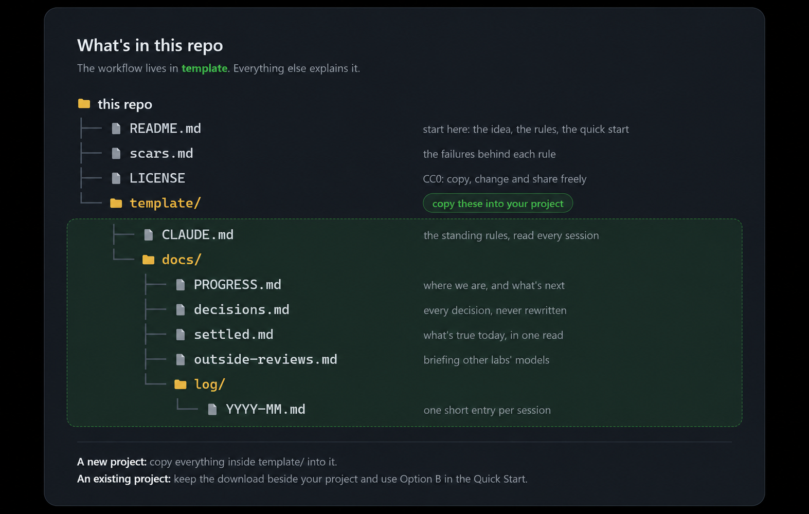

# A bare-bones workflow for building with AI agents when you don't code

*What this folder is: a small set of plain-text files that let one person who doesn't code run a long software project with an AI coding agent, and bring in models from other labs as challengers. Set up the templates using the Quick Start. The agent reads the standing rules and picks up where the project left off. The Markdown files work with any agent that can read and update them.*

## The idea in one paragraph

AI agents forget everything between sessions, agree too easily, and will happily undo last week's work if nobody stops them. So the project's memory lives in a few files the agent must read and keep, the owner makes the calls only a human can make (taste), the agent makes and records the technical ones, and outside models are asked to argue before money is spent and after anything surprising. Results are judged by the owner looking and listening, not by reading reports.

## Who does what

| Who | Decides | Never |
|---|---|---|
| **The owner** (not a coder) | Goals, priorities and taste: what gets built and in what order; how it looks, sounds, feels and reads; privacy; money; reversing any decision of theirs | Has to read code, review pages or long reports |
| **The coding agent** (one at a time) | Technical: how a thing is built, which test, trial settings, tidy-ups. Each one recorded in a line the owner can overturn | Reverses an owner's decision silently, or guesses at taste |
| **Outside reviewers** (models from other labs) | Nothing. They challenge, draft and point out what was missed | See private material, or have a reply acted on before it is checked against the code |
| **A design model** (optional) | Drafts art or studies in its own folder | Edits the code. The agent copies each approved handoff into the repo the day it wires it, and checks it |

## The files

All six are in `template/`, laid out as they sit in your project. Every placeholder is in `[square brackets]`.

**Start with three if you're curious.** Try the standing rules, `docs/PROGRESS.md` and the monthly log on a small project. Keep decisions in the log until they become hard to find, then add `decisions.md` and `settled.md`. Add the outside-review guide when you need a second opinion.

| File | What it holds | Read |
|---|---|---|
| `CLAUDE.md` (or your agent's equivalent) | The standing rules. Short, with a size limit | Automatically, every session |
| `docs/PROGRESS.md` | Where we are, next, queued (with why not now), waiting for the owner, known limitations | Start of every session |
| `docs/decisions.md` | One row per decision, with the reason and whose it was. Never rewritten | At the decision round and the wrap |
| `docs/settled.md` | What is true today, by area, in one read, pointing at the rows | At the decision round |
| `docs/log/YYYY-MM.md` | One short entry per session | At recovery and wrap, and for recent Friction lines |
| `docs/outside-reviews.md` | How to brief another lab's model, and the index of notes between models | When a review is due |

Also here, outside `template/`: `scars.md`, the failures behind each rule.

## A session's shape

1. **Read** `PROGRESS.md` and, if you use it, `settled.md`. **Crash check:** compare the last log entry with recent commits and the work still in the folder. Recover what you can confirm. Leave unexplained edits in place and mark them unverified.
2. **The decision round:** one short message from the agent with at most three decisions for the owner, often none, and no code yet. A decision that turns up mid-build is asked then; the agent carries on with what doesn't depend on it. The round also reads recent log entries' Friction lines (below), and anything that has come up three times becomes one of the decisions.
3. **Build**, in small surgical edits. Before editing, start the log entry with the session ID, scope and starting commit. Record the owner's approvals in that entry when they happen.
4. **Check:** run the tests for what the change could affect, by name. Broaden the checks when shared code, settings or saved data formats change and before release. Before release, also try the main task as a user would.
5. **Hand the owner something to see or hear:** a plainly named before/after pair in a folder. Keep the approved version as the default until the owner chooses.
6. **One documents round, at the end:** finish that log entry, update `PROGRESS.md`, record decisions, refresh `settled.md` where used and measure the files. A small session writes the log and decision rows and touches the other files only if something there changed.
7. **Commit.** Save checked steps as local commits as you go. Commit the wrap at the end. Sessions are numbered (`S1`, `S2`...) and named for what they advance.

### What recovery looks like

In this invented example, S21 starts from commit `a1b2c3d` to try a larger subtitle size. The log records the scope before any edits. The session hits its usage limit after making a preview but before the owner sees it. The next session finds the preview, leaves a separate unexplained settings edit in place, and records that the preview is waiting for approval. The old size is still the default. Once the owner chooses, the agent records the choice and updates the default if needed.

## The rules, and why each exists

- **The owner decides taste; the agent decides the technical, and writes it down.** The owner shouldn't be asked about test settings, and the agent shouldn't guess what "feels right". Recording the agent's calls keeps them overturnable.
- **At most three decisions in the opening round.** More than three and the owner skims; fewer, better-framed choices get real answers.
- **One writer in the project at a time.** The same session writes the code and the shared workflow files, including the session log. Others may read, research or draw in their own folders.
- **Nothing is undone silently.** Record the earlier decision and the reason for reversing it. Use a temporary switch when comparing both versions would help. Give it a decide-by date and list overdue switches in the opening round. Once the owner has chosen, retire the switch in the next session. A change in daily use with no complaint by its date is settled; before its switch goes, file the old way's settings, assets and a runnable copy, because a recording of it can't be run again. Before a hard-to-undo change to saved data, record how you'll restore it and check the backup.
- **What the model is handed is checked against its prompt.** Memory and context added beside the prompt can quietly contradict it, and nothing flags it. Any change to them is read against the whole prompt first.
- **Surgical edits.** No file rewritten whole; a section at a time, the diff read before the commit. Whole rewrites lose things nobody notices for weeks.
- **Test what the change could affect.** Full suites can be slow or heavy on a home machine; targeted tests run every time instead of being skipped. What wasn't run is logged. A pass counts only from a run in the same session whose output shows how many tests ran, never from memory: a run that tests nothing can still finish "green".
- **Never loosen a test just to make it pass.** If the intended behaviour changes, record why the expectation changed and update the test to check it.
- **Size limits on the docs.** Files the agent reads every session have a cap. Without one they bloat until the agent skims them, and the important line is the one it skips. At the limit, nothing is deleted: older lines move word for word to their own file, leaving a pointer, so `settled.md` can stay a short summary of what's true now. And `PROGRESS.md` holds only what's still open: what a session did goes in the log, or PROGRESS slowly turns back into a diary.
- **Every file says what it is** in a short note at the top: purpose, inputs, outputs, why. A fresh agent (or you, in six months) needs no tour.
- **Ideas go in PROGRESS with why not now.** Nothing is lost, and nothing sneaks in.
- **The eye and ear are the gate.** For anything about feel, the change is done when the owner has seen or heard the preview and made the call. Agents are bad judges of taste and good at sounding sure.
- **A queue limit for the owner.** At most three things wait for the owner to look at or hear; nothing new is added until one is judged.
- **Ask before every paid run.** The agent states the count and the cost and waits for a yes; tests use a cheaper model wherever one can stand in. A standing yes under a small amount was tried, and lasted a day: the test runs that day cost more than eight times the real use.
- **Is it worth it?** Every test, fix or proposal comes with what it means in daily use and an honest call, and "can you live with it?" is always a real option. Many sessions in, the owner loses track of what a test is for; this is the line that lets them drop the ones that don't matter.
- **Private stays private.** The owner's personal material lives outside the repository; agents open it only for a task that needs it; tests use invented details. Agents never read a secrets file whole, since it lands in the session's history, and other tools' snapshots get checked for private files too.
- **Deleting files needs a list, not a count.** A clear-out goes file by file, each checked against the backup first. A count can be right while the wrong files go.
- **Limitations are written, not hidden.** What is known and not fixed goes in a list the next session reads.
- **A new place retires an old one.** A new folder, file or routine says what it replaces, and the old one goes in the same session. Otherwise notes end up waiting in a dozen places and nobody knows which is current.
- **One home for each fact.** Other files point to it instead of copying it. A number that keeps changing, like a count or a size, comes from a script rather than being typed in. Copies drift, and then nobody knows which is right.
- **Small sessions, small paperwork.** A quick fix with nothing for the owner to see or hear, no new switch and only a few lines of code writes a log entry and its decision rows, and nothing else unless something there changed. If in doubt, it isn't small. Without this, the write-up for a 15-line fix takes longer than the fix.
- **The workflow tidies itself through Friction lines.** Any log entry may end with one line on what in the workflow felt heavy or confusing. When the same friction has come up three times, the opening round puts it to the owner as a decision. That replaces a scheduled "review the workflow" session: a fix happens only once the friction has earned it, so the rules don't grow just because a review felt it should add something.
- **Evidence in three kinds, kept apart.** What our own tests showed, what someone (or a model) thinks, and what published work says. A citation is marked verified or not. Otherwise a model's opinion starts to read like a result, and an invented paper like a source.
- **Agree how things will be judged before comparing them.** Write down what "better" means first. The current way is always one of the options, and "change nothing" is a valid result. Without it, the test gets quietly shaped around whichever option the agent already liked.
- **The builder never reviews its own work blind.** A blind review comes from a different model or a fresh session that didn't build it. A builder asked for a "fresh" read finds what it meant to write, not what it wrote.
- **Briefs are generated, not written.** Tables, counts and examples in a brief come straight from the project's own files by script; hand-written prose is one short note, and the fresh read stays. The mistakes in briefs live in the prose.

## Outside reviews, in short

Before money is spent on a design, and after a result that surprised anyone, the agent writes a short self-contained brief, renamed and with counts only, that the owner pastes into a model from another lab. One reviewer per question, never a review of a review. A fresh agent that didn't write the brief reads it before it goes, and a sent brief is never changed. Models with no memory get a pasted baseline first, then "what happened since". Briefs go out from one folder and replies come back to one other; notes between models are listed in one shared index. Every reply is checked claim by claim against the real code before anything follows from it. Full method and templates: `template/docs/outside-reviews.md`.

## Quick start (copy-paste into your agent)

1. **Get the files:** on this repo's GitHub page, press the green **Code** button, then **Download ZIP**, and unzip it.
2. **Choose how to bring them in.**
   - *A brand-new project:* copy everything inside `template/` into the new project's folder, keeping `docs/` as it is. For the three-file trial, copy only the standing rules, `PROGRESS.md` and `log/YYYY-MM.md`, keeping their paths. Then use Option A.
   - *An existing project:* keep the unzipped download beside your project. Give the agent the path to its `template/` folder in Option B.
3. **Open your agent in the project folder and paste the prompt.** If your agent uses a different startup file, put the standing rules there (for example, in `AGENTS.md`). Merge with any instructions you already have.

**Option A: a brand-new project**

> Read the standing rules and the workflow files I copied into `docs/`. Ask up to three plain-English questions at a time to fill the project-specific settings. Keep the suggested limits and leave placeholders in reusable templates. Rename `docs/log/YYYY-MM.md` to the current month, remove invented entries, start a short project README, and set up PROGRESS. Set up local Git and a `.gitignore` for private files and credentials. Check the files you plan to save for private material and tell me by path if you find any. Show me the proposed commit's file list and wait for my approval before staging and committing just those files locally.

**Option B: an existing project**

> Read the templates at `[full path to the downloaded template folder]`, outside this project. First check existing tracked, staged and untracked files for credentials and private material. Report suspect paths without printing their contents. Pause if private material is already tracked. If this project is new to Git, set up local Git and a `.gitignore`. Show me which safe project files you propose to save and wait for approval before staging and committing just those files locally. If Git already exists, use the last commit as the reference point and preserve existing edits.
>
> Draft the project summary and current state from what you can verify. Ask up to three plain-English questions at a time to fill the project settings, keeping the suggested limits unless I change them. Merge the selected workflow files into the ones I already use. Leave the download outside the repo and remove invented entries from the installed copies. If setup touches a file with existing edits, agree with me on how to preserve them first. Show me the proposed workflow commit's file list and wait for approval. Keep any work already staged out of that commit and preserve it for the owner. Pause if you can't separate the changes safely. Then open the first session with the decision round.

**Optional Git safety hook for Claude Code**

A hook can block the tool calls it watches. This one guards against some of the commands that can lose work (see the first scar). Paste it once setup is done:

> Set up a Claude Code hook that blocks risky Git commands in the shell tool I use. Cover rebase, `reset --hard`, force-push, `commit --amend`, `clean` and `filter-branch`. In a throwaway repository, test each command you claim to block and show the results, including one ordinary Git command that still works. Explain the scope in plain English.

## Honest caveats

Keeping the documents up to date takes perhaps a tenth of a normal session, and a small session's lighter round keeps quick fixes from paying the full price. There's also a cost at the start: the agent has a few files to read before it can get to work, and that uses some of its context window. On my longer builds, that's more than paid for itself. I spend less time explaining where we left off, and we're less likely to redo work or reopen decisions we already made.

The agent can still be wrong. The rules help me spot mistakes and undo them.

These rules are instructions, not locks. An agent can still skip one, most often late in a long session. A Claude Code hook can refuse matching tool calls before they run. Its scope is the configured agent and tools. The Quick Start has a prompt for the Git hook. My other hook checks for background programs the session started after one forgotten run held a CPU core busy for five hours.

Save checked work in scoped commits. Before any operation that could discard work, also check that the work you want to keep has a recoverable copy, including files Git doesn't track. If private material gets committed, alert the owner. Revoke or rotate exposed credentials promptly. Any history cleanup needs the owner's explicit approval and a coordinated plan.

## License

CC0 1.0: copy, change and share any of this freely, no credit needed. See [LICENSE](LICENSE).
